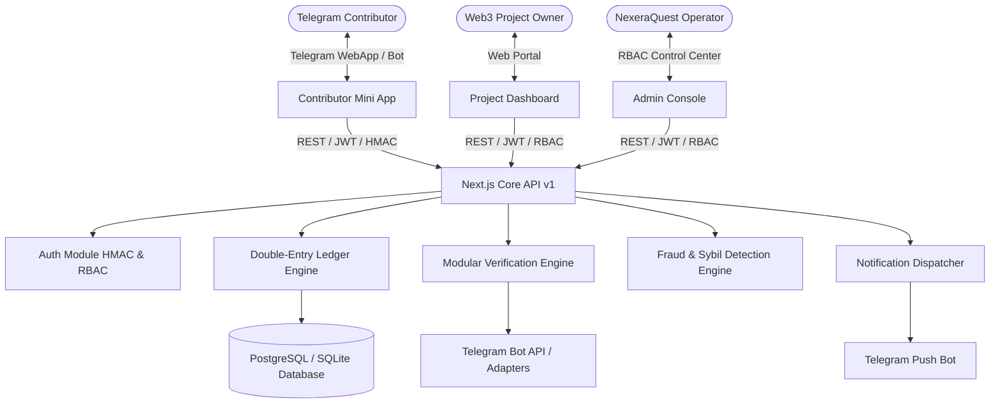

# NexeraQuest Architecture Specification
**QUEST. CONTRIBUTE. EARN.**

## 1. System Overview
NexeraQuest is a Telegram-native Web3 campaign marketplace connecting projects with contributors.
- **Projects** fund campaigns in advance into verified escrow.
- **Contributors** discover campaigns and complete verifiable, measurable tasks.
- **NexeraQuest Engine** verifies task completion cryptographically and structurally.
- **Verified rewards** are credited transactionally into the contributor's internal balance.
- **Contributors** can cash out to external crypto wallets (TON, Arbitrum, Polygon, Ethereum) via an idempotent withdrawal pipeline.
- **Projects** receive real-time campaign telemetry and verified participant records.
- **NexeraQuest Operators** control campaign approvals, fraud detection, dispute resolution, financial ledger auditing, and reconciliation via a dedicated Admin Console.

## 2. Core Experiences
1. **Contributor Experience (`/` & subroutes)**:
   - Optimized for mobile viewports (320px–430px) inside Telegram Mini App.
   - Real-time balance sync, Trust Score visualization, discovery filters, quest state machine, proof upload, and cashout flow.
2. **Project Experience (`/project`)**:
   - Comprehensive portal for campaign creators.
   - Multi-step campaign creation with dynamic pricing economics, participant data table with CSV export, escrow funding, telemetry funnel, and refunds.
3. **Admin Experience (`/admin`)**:
   - Internal operations command center.
   - Campaign approval queue, fraud risk center, dispute resolution, financial ledger auditor, withdrawal authorizations, reconciliation runner, and feature flag management.
4. **Telegram Bot (`apps/telegram-bot`)**:
   - Deep-linking layer (`/start`, `/quests`, `/wallet`, `/profile`, `/referrals`, `/help`).
   - Push notifications for approvals, rewards, and system alerts.

## 3. Financial Invariant & Security Principles
- **Verified Work $\to$ Verified Reward $\to$ Auditable Settlement**.
- No vanity metrics. No client-side balance manipulation.
- Double-entry bookkeeping: every reward credit is backed by a debit from campaign escrow.
- Zero double-spending: all financial endpoints are strictly idempotent.
- Telegram identities are verified using server-side HMAC-SHA256 signatures with 24-hour replay protection.
