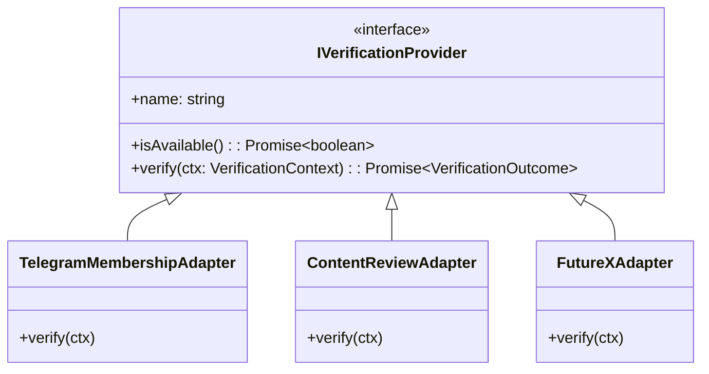

# NexeraQuest Modular Verification Engine

## 1. Modular Verification Architecture
NexeraQuest abstracts verification away from individual UI components. All verification requests execute via registered `IVerificationProvider` adapters:

## 2. Core Adapters

### A. TelegramMembershipAdapter
- **Capability:** Verifies whether a contributor has joined a specified Telegram Channel or Supergroup.
- **Provider Mechanism:** Uses Telegram Bot API method `getChatMember(chat_id, user_id)`.
- **Status Mapping:**
  - `creator`, `administrator`, `member`, `restricted` $\implies$ `VERIFIED`
  - `left`, `kicked` $\implies$ `NOT_VERIFIED`
- **Graceful Failure Handling:** If Bot API is down or bot is not in channel, returns status `UNAVAILABLE` with `retryable: true`. Never falsely marks task as failed due to infrastructure downtime.

### B. ContentReviewAdapter
- **Capability:** Verifies structured links, screenshots, or textual analysis.
- **Validations:** URL schema & reachable domain, image size & sha256 checksum, character counts.

### C. Future Adapters (Interface Ready)
- `XFollowProvider`: Twitter API v2 follow & retweet verification.
- `DiscordRoleProvider`: Discord Bot API guild member & role verification.
- `OnChainProvider`: EVM & TON contract state & token holding verification.
