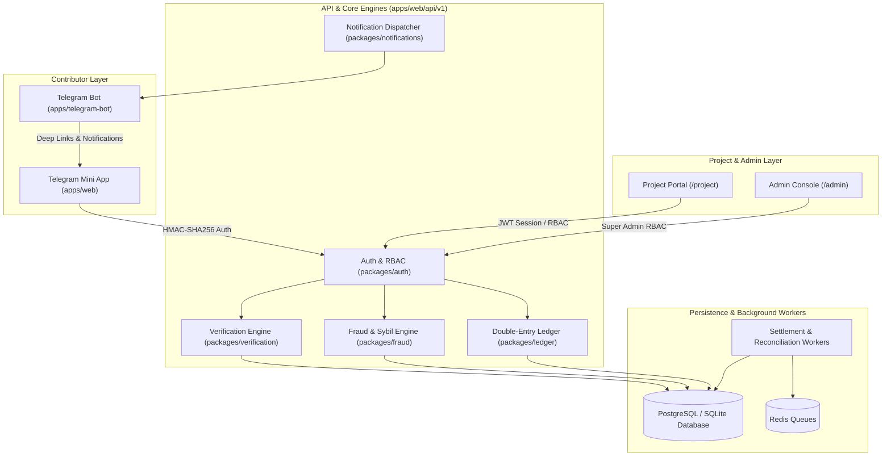
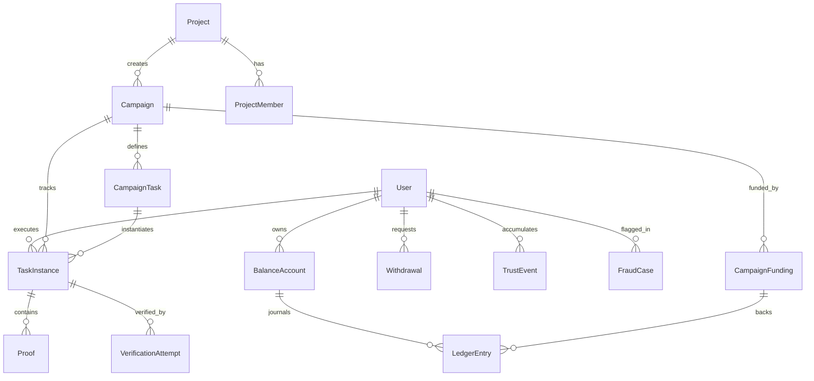

# NexeraQuest — Complete Production Product Walkthrough

**Tagline:** *QUEST. CONTRIBUTE. EARN.*  
**Core Invariant:** *Verified work → verified reward → auditable settlement.*

---

## 1. Product Overview & System Architecture

NexeraQuest is a production-grade Telegram-native marketplace connecting Web3 protocols with contributors under a strict operational philosophy: **never reward vanity metrics; only reward verifiable, auditable work**.

The platform is designed around four tightly integrated layers:
1. **Contributor Experience (Telegram Mini App):** Mobile-first Telegram Mini App (`/`) for browsing campaigns, completing tasks, submitting proofs, viewing internal balances, and requesting withdrawals.
2. **Project Experience (Project Portal):** Enterprise dashboard (`/project`) for protocol operators to create campaigns, calculate dynamic pricing, lock escrow funding, inspect real-time acquisition funnels, and export participant data.
3. **Admin Experience (Operations Console):** Internal command center (`/admin`) for platform operators to review campaigns, arbitrate disputes, monitor sybil/fraud signals, approve withdrawals, inspect the double-entry financial journal, and run balance reconciliation.
4. **Telegram Bot Layer (`apps/telegram-bot`):** Deep-linking, authentication gateway, and automated push notification daemon.



---

## 2. Contributor Experience Walkthrough

The Contributor Mini App is hosted at the application root (`/`) and features automatic Telegram WebApp theme detection, safe-area viewport padding, and an interactive phone preview frame for desktop environments.

### 2.1 Authentication & Server-Side Security
When a user launches the Mini App inside Telegram, the client delivers the raw Telegram `initData` query string. The server never trusts client-supplied user parameters:
- The backend cryptographically recalculates the `HMAC-SHA256` signature using the bot token secret key.
- It verifies that the authentication timestamp is within 24 hours to prevent replay attacks.
- Once validated, it issues an HTTP-only session JWT.

### 2.2 Home Dashboard
The home tab gives contributors an immediate snapshot of their account status:
- **Telegram Identity & Verified Badge:** Live username and profile badge.
- **Trust Score Gauge:** Reputation score (0–100) reflecting historical reliability and submission quality.
- **Financial Balance Segregation:** Distinguishes between **Available** (spendable/withdrawable), **Pending** (under verification or cashout lock), and **Total Earned**.
- **Active Quests & Featured Campaigns:** Direct access to campaigns with remaining slots.

### 2.3 Quest Discovery & Filtering
Contributors can navigate to the **Explore** tab to browse active campaigns:
- **Category Filters:** Community, Social, Growth, Creative, Testing, and Protocol Partnerships.
- **Sorting Options:** Highest Reward, Newest, Most Available Slots.
- **Eligibility Pre-Checks:** Hides or disables campaigns where contributor Trust Score or geographic restrictions do not meet requirements.

### 2.4 Quest Execution State Machine
Every quest follows a strict server-side state machine:
$$\text{AVAILABLE} \longrightarrow \text{STARTING} \longrightarrow \text{IN\_PROGRESS} \longrightarrow \text{VERIFYING} \longrightarrow \text{APPROVED}$$

1. **Starting a Quest:** Clicking **View Quest** opens the `QuestExecutionModal`, showing the exact reward, requirements, instructions, and proof guidelines.
2. **In Progress:** The user clicks **Start Quest**. The backend creates an immutable `TaskInstance` in state `IN_PROGRESS`. Duplicate task starts are rejected by database unique constraints.
3. **Task Completion:** The user performs the external action (e.g., joining an official Telegram community, testing a dApp, or submitting a URL).
4. **Verification & Proof Submission:** The contributor submits required proof (URL, screenshot hash, or Telegram ID). The `VerificationEngine` dispatches the adapter (e.g., `TelegramMembershipAdapter`).

### 2.5 Instant Celebration & Atomic Reward Credit
Upon server-side verification:
- Exactly **one** reward is created via an atomic database transaction.
- The `TaskInstance` updates to `APPROVED`.
- The contributor's `BalanceAccount.available` increases by the task reward amount.
- An immutable `LedgerEntry` of type `TASK_REWARD` is recorded with transaction ID, task ID, and timestamp.
- The celebratory modal displays the updated balance, Trust Score increment (+2), and transaction reference.

### 2.6 Wallet & Withdrawal Lifecycle
The **Wallet** tab displays the contributor's financial journal:
- **Available Balance:** Eligible for withdrawal.
- **Pending Balance:** Funds locked during withdrawal processing.
- **Transaction History:** Categorized list of `TASK_REWARD`, `WITHDRAWAL_REQUEST`, and `WITHDRAWAL_PAYOUT` with cryptographic transaction hashes.
- **Withdrawal Modal:** Contributors select network (`TON`, `Arbitrum`, `Polygon`, `Ethereum`), asset (`USDT`, `USDC`, `TON`), specify their destination address, and confirm cashout.
- **Idempotency Protection:** Prevents duplicate cashout clicks or replay attacks from draining funds.

---

## 3. Project Portal Walkthrough

The Project Portal (`/project`) provides Web3 protocol teams with full campaign lifecycle management and real-time acquisition analytics.

### 3.1 Multi-Step Onboarding
Protocol operators submit project name, logo URL, official website, verified social handles, and contact details. Projects receive a `VERIFIED` status upon administrative review.

### 3.2 Dynamic Campaign Creator & Pricing Engine
The campaign builder provides an 8-step wizard:
1. **Basic Info:** Title, category, and campaign media banner.
2. **Task Definition:** Action type (Telegram join, URL visit, dApp review) and step-by-step instructions.
3. **Economics & Reward Pool:** 
   - Reward per completion ($R$)
   - Target participant capacity ($N$)
   - Reward Pool = $R \times N$
   - Platform Fee = $\max(\text{Pool} \times 15\%, \$25.00)$
   - Total Required Escrow = $\text{Pool} + \text{Fee}$
4. **Eligibility Criteria:** Minimum Trust Score threshold (e.g., 70+), duplicate exclusion, account age.
5. **Verification Configuration:** Automatic adapter (`TelegramMembershipAdapter`) or manual review.
6. **Schedule & Expiry:** Start date, duration, and maximum budget caps.
7. **Review & Pre-Flight:** Visual preview of contributor card.
8. **Escrow Lock:** Protocols deposit funds into escrow. A campaign cannot become `LIVE` without verified funding.

### 3.3 Real-Time Funnel Telemetry & Participant Table
Campaign operators monitor real-time telemetry:
- **Acquisition Funnel:** Viewed $\rightarrow$ Started $\rightarrow$ Completed $\rightarrow$ Verified $\rightarrow$ Rewarded.
- **Budget Burn:** Live tracking of locked escrow vs. distributed rewards.
- **Participant Table:** Authorized view of contributor handles, completion timestamps, Trust Scores, and verification statuses.
- **Audited CSV Export:** Operators can download participant datasets. Every export action is recorded in the platform `AuditEvent` log.

---

## 4. Admin Operations Console Walkthrough

The Admin Console (`/admin`) is a dedicated operational control system with role-based access control (`SUPER_ADMIN`, `FINANCE_ADMIN`, `RISK_ADMIN`).

### 4.1 Operations Command Center
The overview tab aggregates platform-wide operational health:
- Active contributors, live campaigns, and total escrow value.
- Real-time queue counters: Pending Campaign Approvals, Open Disputes, Flagged Fraud Cases, and Pending Withdrawals.
- System health status and active alert feeds.

### 4.2 Campaign Approval Queue
Administrators inspect newly submitted campaigns prior to launch:
- Review task clarity, verification adapter settings, and economics.
- Actions: **Approve** (transitions campaign to `APPROVED`/`LIVE`), **Pause**, **Reject**, or **Request Changes**.
- Every decision requires an authenticated operator ID, timestamp, and audit justification.

### 4.3 Fraud & Sybil Intelligence Center
The `FraudEngine` continuously monitors activity patterns and flags suspicious behaviors:
- **Velocity Spikes:** Rapid completion of tasks faster than humanly possible (>5 tasks/min).
- **Proof Reuse:** Duplicate hashes or URLs submitted across different contributor accounts.
- **Referral Loops:** Cyclic or self-referrals detected via graph traversal.
- **Operator Controls:** Ability to inspect evidence, adjust risk severity, freeze suspicious accounts (blocking withdrawals and quest starts), or unfreeze cleared contributors.

### 4.4 Dispute Resolution Center
Contributors or projects can escalate contested verification outcomes:
- Operators review original task instructions, submitted proof, verification timestamps, and fraud signals.
- Binding decisions: **Uphold Rejection**, **Approve Reward**, or **Partial Adjustment**.

### 4.5 Financial Ledger & Automated Reconciliation
The core financial ledger enforces double-entry accounting invariants:

$$\text{Platform Liability} = \sum (\text{Rewards} + \text{Deposits} + \text{Adjustments}) - \sum (\text{Withdrawal Payouts})$$

$$\text{Recorded Liability} = \text{BalanceAccount.Available} + \text{BalanceAccount.Pending}$$

$$\text{Reconciliation Invariant: } |\text{Platform Liability} - \text{Recorded Liability}| = 0$$

- **Reconciliation Runner:** Operators trigger automated audits across all accounts.
- **Audit Verification:** Checks every ledger entry, detects orphan transactions or double credits, and writes an immutable `ReconciliationRun` record.

### 4.6 Withdrawal Authorization Queue
Cashouts above configured risk thresholds require operator sign-off:
- Risk scores are calculated based on contributor account age, recent disputes, and velocity.
- Operators approve, hold, or reject withdrawal requests.
- Rejection automatically unreserves pending funds back to `available` with an audit trail.

---

## 5. Technical Deep-Dive: Core Packages

### 5.1 Monorepo Architecture
- [`packages/types`](file:///d:/Anitgravity Dapp/packages/types): Strict TypeScript interfaces, enums (`CampaignStatus`, `TaskStatus`, `WithdrawalStatus`, `LedgerEntryType`), DTOs, and API envelopes.
- [`packages/config`](file:///d:/Anitgravity Dapp/packages/config): Dynamic pricing engine, platform fee formula, supported networks (`TON`, `Arbitrum`, `Polygon`, `Ethereum`), asset schemas (`USDT`, `USDC`, `TON`), and feature flags.
- [`packages/database`](file:///d:/Anitgravity Dapp/packages/database): Prisma schema defining 25+ relational models with foreign key constraints, composite unique indexes, and production seed data.
- [`packages/ledger`](file:///d:/Anitgravity Dapp/packages/ledger): Atomic double-entry journal, escrow reservation, reward distribution, withdrawal processing, and reconciliation.
- [`packages/verification`](file:///d:/Anitgravity Dapp/packages/verification): Modular adapter architecture with `TelegramMembershipAdapter` and `ContentReviewAdapter`.
- [`packages/fraud`](file:///d:/Anitgravity Dapp/packages/fraud): Risk scoring engine, velocity tracking, sybil clustering, and account freeze enforcement.
- [`packages/auth`](file:///d:/Anitgravity Dapp/packages/auth): Cryptographic Telegram `initData` validator, JWT signing, and RBAC authorization middleware.
- [`packages/notifications`](file:///d:/Anitgravity Dapp/packages/notifications): Multi-channel dispatcher for Telegram Bot messaging and in-app alerts.

### 5.2 Database Entity-Relationship Summary



---

## 6. Automated Testing & Verification Suite

The repository contains 19 automated tests executed via Vitest, covering all critical money, security, and state machine paths:

```bash
$ npx vitest run

 ✓ tests/telegram-auth.test.ts (4 tests) 7ms
   ✓ Telegram WebApp Cryptographic Authentication > validates authentic initData correctly
   ✓ Telegram WebApp Cryptographic Authentication > rejects forged hash signatures
   ✓ Telegram WebApp Cryptographic Authentication > rejects expired auth tokens (> 24 hours)
   ✓ Telegram WebApp Cryptographic Authentication > extracts and parses Telegram user profile correctly

 ✓ tests/state-machine.test.ts (3 tests) 4837ms
   ✓ State Machine & Transition Invariants > campaign transitions from DRAFT to FUNDING_REQUIRED and then FUNDED
   ✓ State Machine & Transition Invariants > campaign advances to LIVE and can be PAUSED with a documented reason
   ✓ State Machine & Transition Invariants > task instance moves through strict progression: IN_PROGRESS -> SUBMISSION_REQUIRED -> APPROVED

 ✓ tests/ledger-concurrency.test.ts (5 tests) 5130ms
   ✓ Financial Ledger & Concurrency Safety > locks project campaign escrow funds accurately
   ✓ Financial Ledger & Concurrency Safety > credits task reward transactionally and creates immutable ledger entry
   ✓ Financial Ledger & Concurrency Safety > strictly prevents duplicate reward credits on replayed requests (Idempotency Invariant)
   ✓ Financial Ledger & Concurrency Safety > locks balance on withdrawal request and prevents double cashouts
   ✓ Financial Ledger & Concurrency Safety > runs double-entry ledger reconciliation and detects balance discrepancies

 ✓ tests/pricing-and-fees.test.ts (4 tests) 8ms
   ✓ Configurable Pricing & Platform Fee Engine > calculates default 15% platform fee with standard reward pool
   ✓ Configurable Pricing & Platform Fee Engine > enforces minimum platform fee floor on small reward pools
   ✓ Configurable Pricing & Platform Fee Engine > calculates total required funding matching escrow lock specifications
   ✓ Configurable Pricing & Platform Fee Engine > supports custom fee overrides for enterprise partner tiers

 ✓ tests/fraud-engine.test.ts (3 tests) 6486ms
   ✓ Fraud & Sybil Intelligence Engine > detects velocity spikes when multiple tasks are created rapidly
   ✓ Fraud & Sybil Intelligence Engine > detects high rejection ratios and generates severe fraud cases
   ✓ Fraud & Sybil Intelligence Engine > allows operators to freeze and unfreeze suspicious contributors with audit logs

 Test Files  5 passed (5)
      Tests  19 passed (19)
   Duration  8.23s
```

---

## 7. Operations & Production Runbook

### 7.1 Running Locally
```powershell
# 1. Start Web Application (Contributor, Project, Admin, API)
npm run start --workspace=apps/web

# 2. Start Background Workers
npx tsx workers/settlement-worker.ts
npx tsx workers/fraud-worker.ts
npx tsx workers/reconciliation-worker.ts

# 3. Start Telegram Bot Daemon
npm run start --workspace=apps/telegram-bot
```

### 7.2 Docker Deployment
```bash
# Build and orchestrate Web, Postgres, and Redis containers
docker compose up -d --build
```

### 7.3 Health Telemetry & OpenAPI Endpoints
- **Health Check:** `GET /api/v1/health`
- **OpenAPI Schema:** `GET /api/v1/openapi.json`
- **Mini App:** `http://localhost:3000/`
- **Project Portal:** `http://localhost:3000/project`
- **Admin Console:** `http://localhost:3000/admin`
